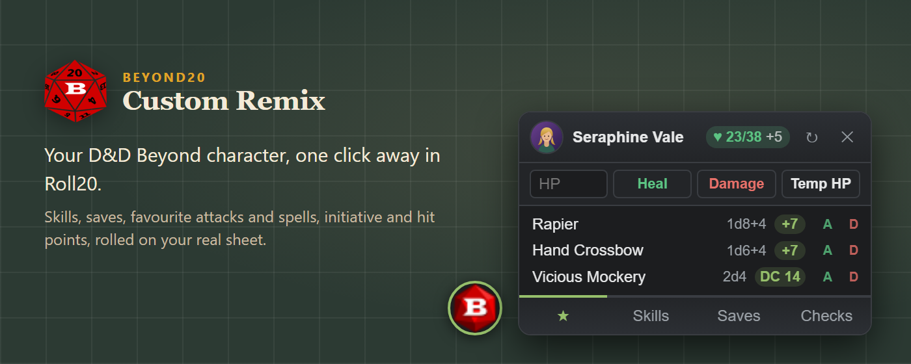
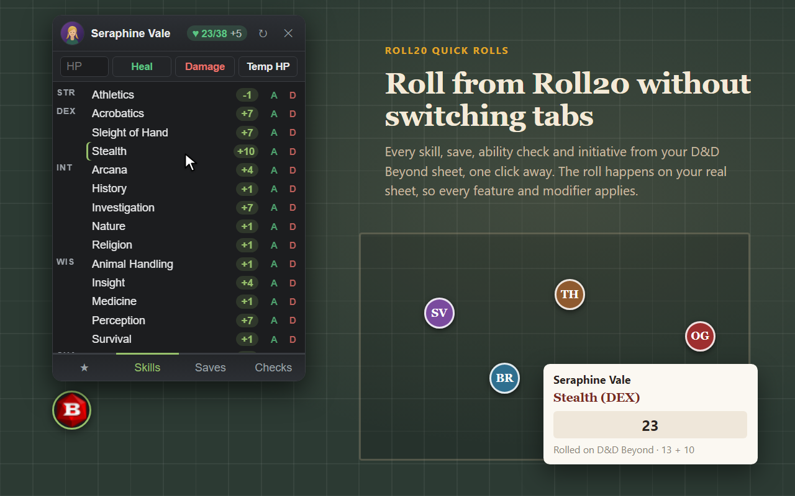
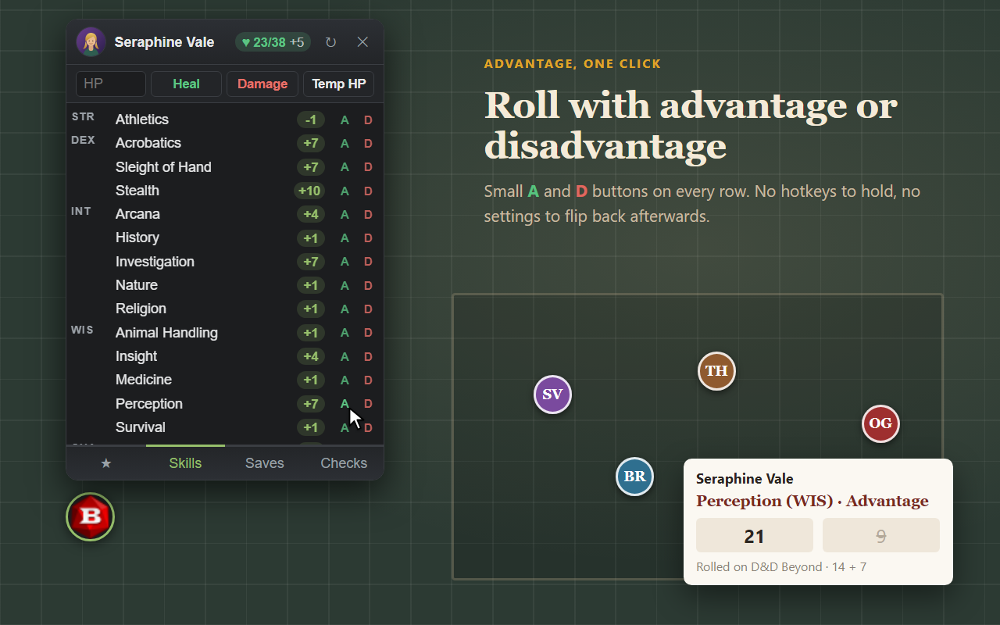
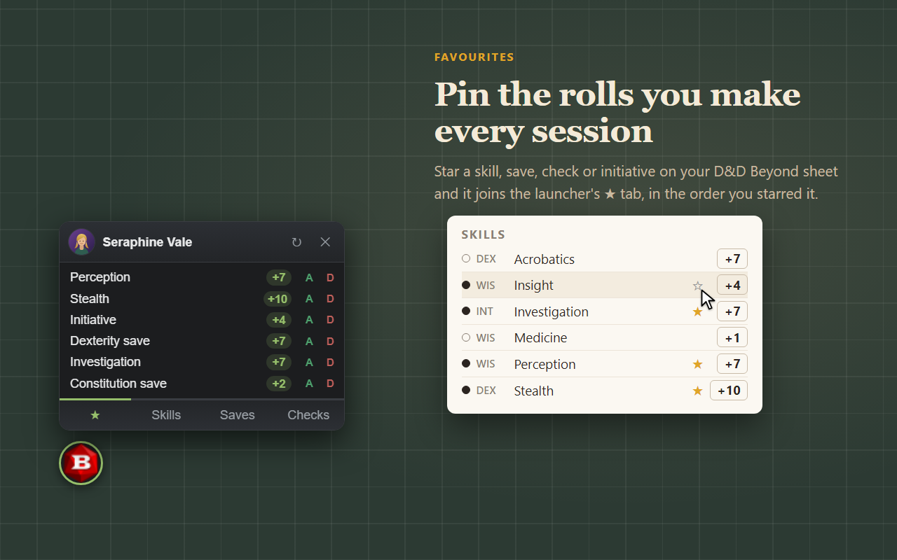
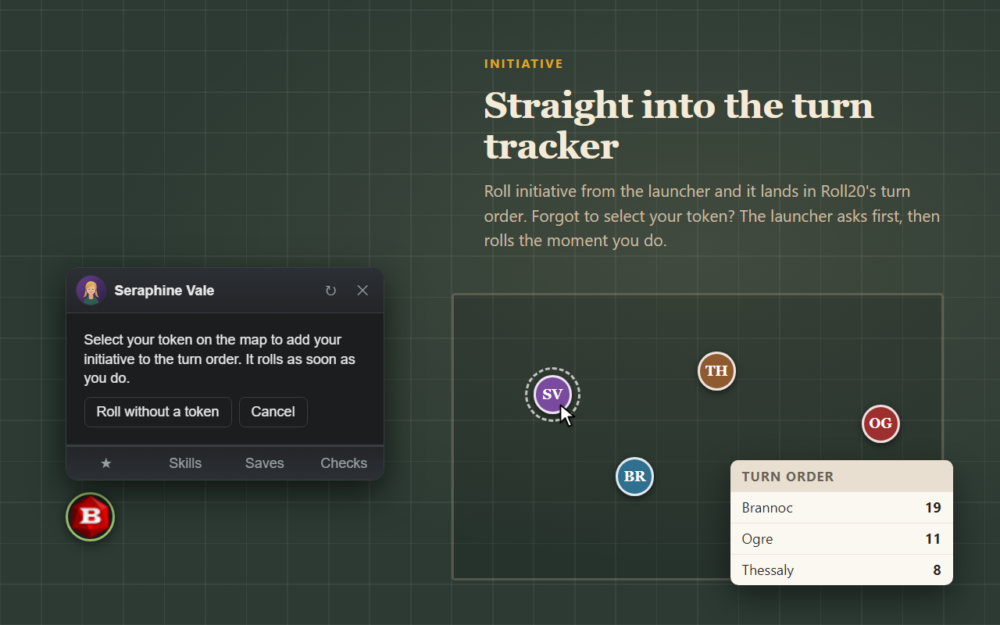
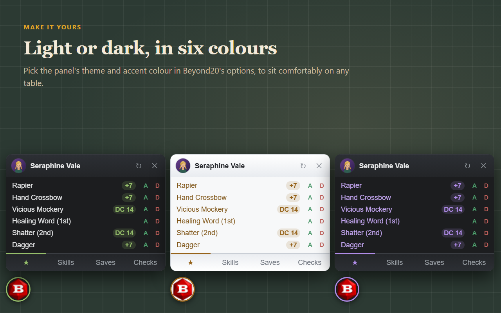

# Beyond20 Custom Remix



A fork of [Beyond20](https://beyond20.here-for-more.info/), the extension that sends rolls from
your D&D Beyond character sheet to Roll20, Foundry VTT and Discord. Everything Beyond20 does still
works. This fork adds a **quick roll launcher** to Roll20, so you can play from your D&D Beyond
sheet without leaving the Roll20 tab.

Not the official Beyond20, and not affiliated with or endorsed by the Beyond20 project.
**Docs:** <https://xiaoyu-ben-wang.github.io/beyond20-remix/>

## The quick roll launcher

Click the portrait button on the Roll20 page to open it. Every roll happens on your real D&D
Beyond sheet, in the background, so class features, effects and custom modifiers all apply. The
result appears in Roll20 chat as usual.

| | |
|:---:|:---:|
|  |  |
| **Skills, saves, checks and initiative**, one click away | **Advantage or disadvantage** with the A and D buttons on every row |
|  |  |
| **Favourite attacks and spells**: star them on your sheet, roll them from the ★ tab | **Initiative into the turn tracker**, asking you to select your token first |

- **Hit points** sit next to your name. Type an amount and click Heal, Damage or Temp HP to change
  them on your sheet.
- **Several characters?** It remembers which one you play in each game, and asks rather than
  guesses.
- **Light or dark, in six colours.** It can be turned off in the options.



## Install

1. If you have the official Beyond20 installed, disable it, or both will answer every roll.
2. Download the zip for [Chrome](https://github.com/Xiaoyu-Ben-Wang/beyond20-remix/releases/latest/download/beyond_20-2.21-remix.2-chrome.zip)
   or [Firefox](https://github.com/Xiaoyu-Ben-Wang/beyond20-remix/releases/latest/download/beyond_20-2.21-remix.2-firefox.zip)
   and extract it.
3. Load it:
   - **Chrome:** open `chrome://extensions`, turn on Developer mode, click *Load unpacked* and pick
     the folder.
   - **Firefox:** open `about:debugging#/runtime/this-firefox`, click *Load Temporary Add-on* and
     pick `manifest.json` in the folder.

Then open your game in one tab and your D&D Beyond character sheet in another.

## Develop

```bash
npm install
npm run build     # build/chrome and build/firefox
npm test
npm run package   # release zips in build/artifacts
```

The extension's version is numeric (`2.21.2`), as browsers require; the `remix` label lives in the
release tag (`v2.21-remix.2`). The launcher's messages are documented in [docs/api.md](docs/api.md).
`store/screenshots/capture.sh` regenerates the screenshots above.

## License

GPL v3; see [LICENSE](LICENSE). The options page is partly from
[D&D Beyond Toolbox](https://github.com/mouse0270/Beyonds-Toolbox/) under the MIT license
([LICENSE.MIT](LICENSE.MIT)).

Credits: the icon is based on a public domain
[openclipart image](https://commons.wikimedia.org/wiki/File:Twenty_sided_dice.svg); roll badge icons
by [Jerry Escandon](https://github.com/Jerryescandon); the up arrow in the docs by OCAL
([clker.com](http://www.clker.com/clipart-16838.html)); condition icons mostly from
[game-icons.net](https://game-icons.net/) under CC-BY 3.0, sources in
`FVTT-module/beyond20/conditions/LICENSE`.
